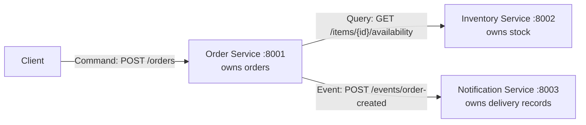

# Module 4 Assignment: Architecture & Service Boundaries

A small online store split into three services. Each service is its own process, owns its own data, and talks to the others over HTTP.

Python 3.9 or newer is enough. There are no third-party packages, so there is nothing to install with pip.

## Run the services

Open three terminals in this repository.

```bash
python3 inventory_service/server.py
```

```bash
python3 notification_service/server.py
```

```bash
python3 order_service/server.py
```

| Service | Address | Role |
| --- | --- | --- |
| Order | http://127.0.0.1:8001 | Accepts orders |
| Inventory | http://127.0.0.1:8002 | Answers stock queries |
| Notification | http://127.0.0.1:8003 | Records that a user was notified |

Sample inventory, owned only by the Inventory Service:

| Item | Quantity on hand |
| --- | --- |
| `laptop` | 5 |
| `keyboard` | 12 |
| `headphones` | 0 |

Ports can be changed with `ORDER_PORT`, `INVENTORY_PORT`, and `NOTIFICATION_PORT`. The Order Service reads `INVENTORY_URL` (default `http://127.0.0.1:8002`) and `NOTIFICATION_URL` (default `http://127.0.0.1:8003`).

## Architecture



The client sends one command to the Order Service. Before the Order Service stores anything, it queries the Inventory Service. After the order is stored, the Order Service publishes an "order was created" event. The Notification Service reacts to that fact. It does not approve or reject the order.

## Responsibility of each component

**Order Service** creates and tracks orders. It is the only service that accepts "create an order." It decides whether a request becomes an order after it hears back from Inventory. It keeps running when Inventory is down and returns an error instead of crashing.

**Inventory Service** tracks whether items can be sold. It answers "is this quantity available?" from the stock it owns. It does not know about orders or customers.

**Notification Service** tells the user that an order was created. It stores a delivery record for each `order_created` event. If it is down, the order still exists. Notification is a side effect, not part of the decision to accept the order.

## Data each component owns

| Component | Data it owns | Data it does not own |
| --- | --- | --- |
| Order Service | Order id, item id, quantity requested, customer email, status, created time | Stock counts |
| Inventory Service | Item id, item name, quantity on hand | Orders and customer emails |
| Notification Service | Notification id, recipient, message, time the event was received | The order record itself. It keeps a copy of the event so it can deliver the message. |

The Order Service does not save `quantity_on_hand`. That number is returned by the query and then discarded. A later design could add a `ReserveStock` command that only Inventory is allowed to handle. This assignment stops at the availability query, so stock is read and not reduced.

## Why these boundaries

Orders, stock, and user notifications change for different reasons and fail in different ways.

- Stock is a shared fact. If the Order Service kept its own copy, two orders could disagree about how many laptops are left. Only Inventory is allowed to answer that question.
- An order is a business decision. The client asks the Order Service to record one. Inventory does not create orders, and Notification does not get a vote.
- Sending a message can fail, be slow, or be retried. That work sits behind an event so a mail problem does not roll back an order that was already accepted.
- Each process can be stopped on its own. The failure test below stops Inventory. Order stays up, rejects the new command, and keeps the orders it already stored.

## Command, Query, and Event

**Check whether an item is available — Query.**

`GET /items/{item_id}/availability?quantity=1` on the Inventory Service.

This reads stock and returns `available: true` or `available: false`. It does not create an order and it does not change the quantity on hand. Repeating the same call returns the same answer, so it is a query.

**Create an order — Command.**

`POST /orders` on the Order Service.

The client is asking the Order Service to change its data: record a new order if the item can be sold. The Order Service is the only service that accepts this command. On success it stores an order and returns `201`. If Inventory says the item is unavailable, it stores nothing and returns `409`.

**Order was created — Event.**

`POST /events/order-created` from the Order Service to the Notification Service.

This is not a request for permission. The order is already stored with status `created`. The message states that fact so Notification can tell the user. If Notification cannot be reached, the Order Service still returns the order and marks `notification` as `not_delivered`.

## Example of a successful request

Inventory, Notification, and Order are all running.

```bash
curl -sS -D - -X POST http://127.0.0.1:8001/orders \
  -H 'Content-Type: application/json' \
  -d '{"item_id":"laptop","quantity":1,"customer_email":"ada@sjsu.edu"}'
```

```text
HTTP/1.0 201 Created
Content-Type: application/json

{
    "order_id": "ord-1",
    "item_id": "laptop",
    "quantity": 1,
    "customer_email": "ada@sjsu.edu",
    "status": "created",
    "created_at": "2026-10-27T05:23:26.114365+00:00",
    "notification": "sent"
}
```

The same run queried Inventory directly:

```bash
curl -sS "http://127.0.0.1:8002/items/laptop/availability?quantity=1"
```

```text
{"item_id": "laptop", "name": "Laptop", "quantity_requested": 1, "quantity_on_hand": 5, "available": true}
```

Notification stored the event:

```bash
curl -sS http://127.0.0.1:8003/notifications
```

```text
{"notifications": [{"notification_id": "ntf-1", "type": "order_created", "recipient": "ada@sjsu.edu", "order_id": "ord-1", "message": "Order ord-1 was created for 1 x laptop.", "received_at": "2026-10-27T05:23:26.114725+00:00"}]}
```

Headphones have zero on hand, so the query result is unavailable and no order is stored:

```bash
curl -sS -D - -X POST http://127.0.0.1:8001/orders \
  -H 'Content-Type: application/json' \
  -d '{"item_id":"headphones","quantity":1,"customer_email":"ada@sjsu.edu"}'
```

```text
HTTP/1.0 409 Conflict
Content-Type: application/json

{
    "error": "item_unavailable",
    "item_id": "headphones",
    "quantity_requested": 1,
    "quantity_on_hand": 0,
    "message": "The requested item is not available."
}
```

## Inventory Service failure test

1. Leave the Order Service running.
2. Stop the Inventory Service (`Ctrl+C` in its terminal).
3. Submit another order.
4. Check that Order is still alive and that the earlier order is still there.

```bash
curl -sS -D - -X POST http://127.0.0.1:8001/orders \
  -H 'Content-Type: application/json' \
  -d '{"item_id":"laptop","quantity":1,"customer_email":"ada@sjsu.edu"}'
```

```text
HTTP/1.0 503 Service Unavailable
Content-Type: application/json

{
    "error": "inventory_unavailable",
    "message": "Inventory service could not be reached. The order was not created. Please retry."
}
```

The Order Service was still listening on port 8001. A health check returned 200:

```text
HTTP/1.0 200 OK
{"status": "ok", "service": "order"}
```

`GET /orders` still returned `ord-1` and did not add a second order. A second submit, this time for `keyboard`, also returned `503` with the same error. The process did not exit.

The handler catches a refused connection, a timeout, and any other network error from Inventory, then responds with `503`. The HTTP server keeps accepting new requests.

## Reflection

Clear service boundaries decide which service may change a piece of data and which services may only ask about it. That matters in a distributed system because each process fails, restarts, and is deployed on its own. In this store only Inventory can say whether stock exists, and only Order can record that an order exists, so a stopped Inventory process cannot leave behind a half-written order or take the Order process down with it. The Order Service answers with `503`, stays up, and keeps the orders it already owns. Notification can change how it delivers messages without becoming the owner of the order, which keeps each failure and each future change inside the service that actually owns that data.
